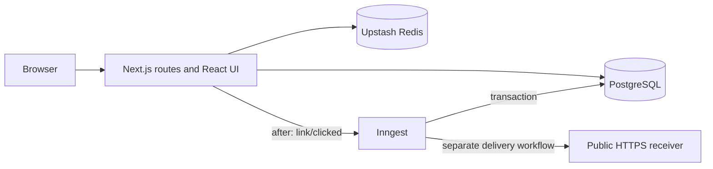

# Architecture

## Responsibility boundaries

React renders interactive components and manages state/effects. Next.js supplies routing, server rendering, route handlers, deployment integration and `after()`. Next.js uses React; it is not an alternative component/state system.

`lib/services` owns business rules. Route handlers authenticate, limit, parse bounded input and invoke those services. `lib/inngest` defines orchestration and `app/api/inngest/route.js` serves the installed SDK v4 integration. 

## Creation and ownership

`services/links.js` normalizes URL syntax without reordering queries or dropping fragments. All primary/device destinations reject non-HTTP(S), embedded credentials and obvious same-service short links. Aliases are case-sensitive, 3-30 characters, alphanumeric first, then alphanumeric/underscore/hyphen; reserved names are checked case-insensitively.

Creation directly attempts a unique INSERT. Each P2002 retry uses a new transaction/code, since a PostgreSQL constraint failure aborts its transaction. Five random attempts bound work. Aliases get one attempt and 409. There is no destination uniqueness constraint.

A session-only preflight returns at most ten owned matching normalized destinations. Existing links are normalized with the migration script. UI reuse is explicit; changing campaign options does not silently select an old link. Anonymous and API clients skip preflight.

CreationRequest reserves `(scope,keyHash)` inside the same transaction as Url. The canonical JSON fingerprint preserves meaningful payload differences. A concurrent retry waits for the unique reservation and returns its committed JSON result; expiry is 24 hours. This protects request retries, independently of random code collisions. The UI uses a synchronous ref guard and retains its key after network failures. Anonymous clients cannot persist authenticated idempotency records.

Every private query includes ownership. Session mutations additionally require a same-origin Origin header. NextAuth retains its built-in OAuth state/CSRF handling and database-session cookies. Email auto-linking is disabled. API keys are random `sl_` secrets stored as SHA-256 hashes; creation is serialized per user to cap active keys at five. QR is public because the short link is public; it exposes no owner/secret data.

## Cache and redirects

Redis namespace `link:v2:` ignores old cache entries containing secrets. Payload contains only primary/device destinations, active/deleted state, expiry and integer version. No count, owner, session, API key or webhook configuration is cached.

A valid hit costs one GET and no TTL renewal. Misses use the indexed PostgreSQL shortCode lookup. Confirmed absent codes get 45 seconds; outages never get negative entries. Positive TTL is 82,080-86,400 seconds, capped at remaining lifetime rounded down; subsecond/expired entries are not cached. Every hit rechecks availability and expiry locally.

Mutation: commit the database version increment, then atomically raise the Redis version floor and delete the entry. Lua cache fill refuses candidates older than the floor. Floors last 25 hours; fills older than ten seconds are rejected. Creation warming also establishes a version floor, preventing a prior negative read from overwriting it. Failed deletion publishes an Inngest retry. TTL bounds staleness if both invalidation and its publication fail. Redis is not transactional with PostgreSQL: the commit/invalidation window and cache metadata eviction are accepted availability trade-offs, not strong read-after-write consistency guarantees. Protect the version metadata from eviction where the service supports it; high-contention or eviction-driven stale reads are a trigger for a stronger cache protocol.

302 means a usable destination, 404 means absent, 410 means inactive/expired/deleted, and 503 means unavailable database without a valid cache. There is no rate operation on a valid redirect. Repeated invalid-code requests use a separate scan quota and negative caching. Device inference uses simple platform indicators; uncertain requests use primary destination.

## Analytics transaction and privacy

Redirect code generates an event UUID and copies bounded request data before registering `after()`. The callback awaits Inngest acceptance. It never starts a detached send. UA parsing, enrichment, database counting and webhooks run in workers.

Capture removes referrer paths/queries/credentials immediately and HMAC-hashes IP with the secret salt; missing salt means no hash, never an unsalted fallback. Country is trusted only when Vercel supplies its platform header (`VERCEL=1`); otherwise Unknown. No external per-click geolocation is called. UA is capped at 512 characters. Browser/OS/device labels use bounded lists; referrer aggregate buckets cap at 100 distinct domains per link/day plus Other.

A transaction inserts ClickEvent with `ON CONFLICT DO NOTHING`. No insertion means successful duplicate suppression. A new event updates lifetime, UTC daily and five dimensional aggregates. The lifetime row serializes per-link milestone allocation and referrer cardinality decisions. Raw insertion and every update roll back together on failure. Unique `(linkId,milestone)` prevents duplicate webhook records. `linkId` references immutable `Url.shortCode`, not the unrelated internal Url.id.

All traffic = human + bot. Both lifetime and date-range counts, charts, countries, devices, browsers, OS and domains select the same column. Dashboard totals/search cover all owned nondeleted links. Retired links retain audit/aggregate data but disappear from ordinary owner lists; public landing totals count historically created links and human clicks.

Accepted delivery guarantee: best effort before Inngest acceptance; at-least-once execution after acceptance; effectively-once database counting by eventId. Events older than 90 days are rejected as expired so replay after deduplication-row retention cannot recount old traffic. More-than-five-minute future timestamps are rejected. UA bot classification is heuristic, not fraud detection.

## Webhooks

At each ten human clicks a persistent delivery snapshot is created within the analytics transaction. Inngest dispatches it in a separate workflow. A five-minute recovery sweep recovers pending publication gaps; this is the delivery table itself, not a per-click analytics outbox.

Five attempts per generation use 5,10,20,40-second sleeps between failed attempts. Rows store status, attempts, safe error summary, timestamps and HTTP status. A database lease plus Inngest per-delivery concurrency prevents overlapping sends; lease expiry allows recovery after crashes. A failed row is the dead-letter record. An owner can reset it to pending with a new retry generation. The receiver must deduplicate event IDs: a network response lost after successful receipt can require another HTTP delivery.

Signature: HMAC-SHA256(secret, `timestamp + "." + exact JSON body`), hex prefixed `sha256=` in X-ShortLinks-Signature. Verify X-ShortLinks-Timestamp against a short clock tolerance, compare signatures in constant time, and deduplicate X-ShortLinks-Event-Id / Idempotency-Key. The body includes the persistent eventId and milestone. This strengthens the prior body-only signature contract; update receivers before rollout.

Destination checks run at save and delivery: HTTPS port443, no credentials, all DNS answers public, pinned chosen address for TLS/Host-preserving delivery, no redirects, three-second timeout and zero response-body consumption. Secrets are never returned/logged/cached. Legacy hooks without a signing secret remain failed until an owner supplies one. Current secrets are used on retries, so coordinate rotations with receivers.

## Migration and rollback

1. Back up PostgreSQL and record restore procedure. Rehearse on a restored staging copy.
2. Review `20260929000000_durable_analytics/migration.sql`. It adds Url fields and new tables/indexes; it does not drop users, sessions, links, aliases or legacy Click rows. DDL may acquire locks: choose a quiet window. New tables are initially empty; existing-table index creation requires normal migration lock planning.
3. Set the migration connection explicitly and run `npx prisma migrate deploy`, then `npx prisma generate`. Never use db push for production.
4. Deploy the new writer/reader and configure Inngest signing/event keys. Stop/drain old writers before validating; aggregates will be partial until backfill completes. New events are counted concurrently with backfill. Historical milestones are not replayed.
5. Run `npm run db:backfill -- --normalize-links`, then `npm run db:backfill`. Both are bounded/resumable using MigrationProgress. Backfill uses deterministic `legacy:<Click.id>` event IDs, discards old IP hashes and sensitive full referrers, and preserves legacy rows until validation.
6. Run `npm run db:backfill -- --validate`. A repeatable-read transaction compares legacy presence, per-link human/bot/all totals, daily totals and each dimension's totals. Only success sets the cleanup gate. Run one backfill operator at a time. Do not restart an old writer after validation.
7. Inspect counts and the Inngest workflows, then allow the hourly retention job to delete at most 5,000 old new events and 5,000 old legacy events per run in 500-row batches. Exact boundary retained: rows strictly older than 90 days are removed. Idempotency cleanup separately removes at most 500 expired records/hour.

Rollback favors disabling workflows and rolling forward a fix. Do not drop additive tables or reverse tombstones. The old application cannot read new aggregate-only click writes and may route tombstoned codes incorrectly; a code rollback therefore needs compatibility patches and reconciliation, not merely a git revert. After retention, old detailed raw analytics cannot be reconstructed from aggregates. Restore backups only through an explicitly approved recovery procedure. No production migration, backfill, deployment or cache flush was performed during this work.

## Failures, monitoring and scaling

Redis down: indexed PostgreSQL fallback; session management warns and continues, anonymous/API writes fail safe. PostgreSQL down: valid cached redirects continue; management returns503. Inngest down: redirects continue and pre-acceptance events can be lost. Webhook errors never roll back clicks. Monitoring down: no behavior change.

Structured logs measure cache hits/misses/fallback/errors, redirects/duration, collisions, publication failures, processing delay, duplicates, webhook attempts and cleanup counts. Optional Sentry sends only safe failure codes with default integrations/PII disabled. Compute p50/p95/p99, cache-hit/fallback rates and failure rates from hosting logs; a hosted metrics dashboard is not provisioned here.

Scale based on evidence: database fallback spikes justify cache-stampede locking; write contention/quota pressure justify batching or regional durable capture; aggregate queries exceeding PostgreSQL capacity justify ClickHouse; operational requirements, not project size, justify containers, Kafka or Kubernetes. None is implemented now.

Official integration references: [Inngest Next.js](https://www.inngest.com/docs/getting-started/nextjs-quick-start), [SDK concurrency](https://www.inngest.com/docs/reference/typescript/v4/functions/concurrency), [CodeQL workflow configuration](https://docs.github.com/en/code-security/reference/code-scanning/workflow-configuration-options).

## CSV and PDF report architecture

`lib/report-options.js` validates scope, traffic and inclusive UTC dates. `lib/services/reports.js` reads owner-scoped Url, LinkDailyStats and LinkDailyDimension rows in a repeatable-read transaction, with indexed link/date queries and `limit + 1` overflow detection. `summarizeReport` is the sole selected-period counting function for dashboard charts, report previews, CSV and PDF. Human-only reports zero bot counts; bot-only reports zero human counts; all-traffic totals sum both. Average divides selected clicks by every calendar day, including zero days. Active range spans days with selected clicks. Dimensions are independent breakdowns; cross-dimension filtering is not supported by this aggregate schema.

`GET /api/reports/export` derives ownership from the session/API key, never a caller-supplied user ID. JSON previews use the dashboard quota; CSV/PDF downloads use a shared owner export quota. Existing limiter behavior is retained: session management fails open during Redis outages; API-key requests fail closed. Responses use private/no-store, safe attachment filenames and explicit MIME types. Archived/tombstoned and anonymous links are excluded. The snapshot keeps totals/dimensions internally consistent while new clicks arrive; downloads at different times can differ as queued events finish.

Raw export selects only allowed fields from ClickEvent, applies ownership, traffic and indexed timestamp filters, and requests at most the configured limit plus one. The start of the complete UTC day must be at or after the exact rolling 90-day cutoff; a partial boundary day is rejected rather than advertised as complete. Older raw rows that have not yet been swept are still not exportable. Aggregate exports do not depend on raw retention or Inngest availability.

`lib/report-csv.js` uses the common CSV sanitizer for every header and value. Leading formulas, including whitespace-prefixed formulas, receive an apostrophe; quotes double, delimiter/newline characters remain inside quoted cells, nulls become empty cells, NUL is removed, non-scalar data becomes an explicit invalid-value marker. UTF-8 BOM improves spreadsheet compatibility. Analytics CSVs additionally enforce a 16 MiB output ceiling.

`lib/report-pdf.js` uses pdf-lib directly on the server. Vector charts use the same report objects, preserving sharpness and light styling without capturing dashboard UI or introducing Chromium. Built-in Helvetica avoids font/network dependencies; unsupported Unicode uses visible placeholders, documented in the report. Text APIs and width measurement prevent markup injection and clipping. Chart rankings show top 8; tables show top 50; full bounded dimensions remain available as CSV. Reports use calendar-day totals, not lifetime totals. PDF rendering is a separate authenticated operation and adds no work to the redirect handler (shared infrastructure contention is still possible).

Bounded direct generation avoids queues, file storage and signed download URLs. No migrations are required. Account/link/date scope, limits and default UTC-only presentation are intentional initial constraints. Library reference: [pdf-lib API](https://pdf-lib.js.org/docs/api/classes/pdfdocument).
